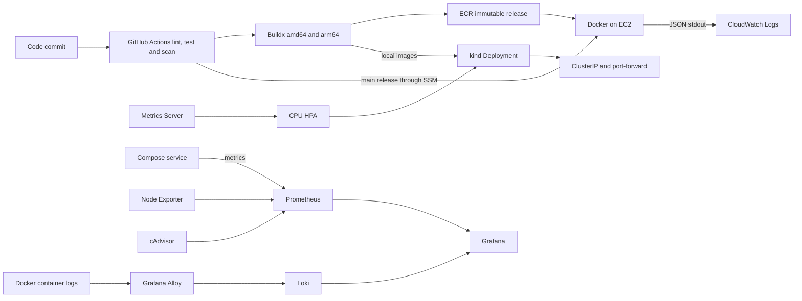
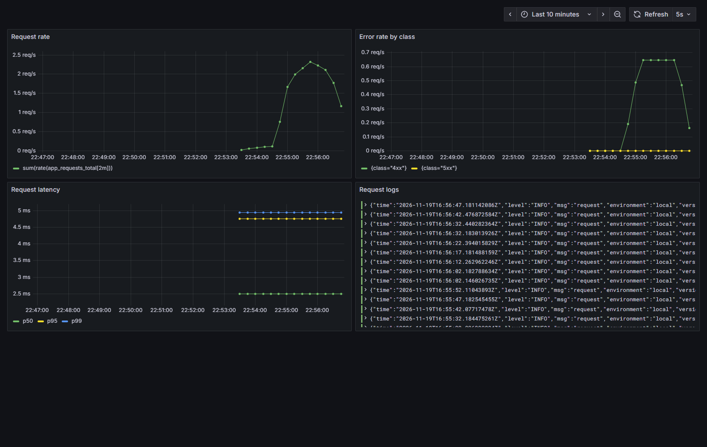
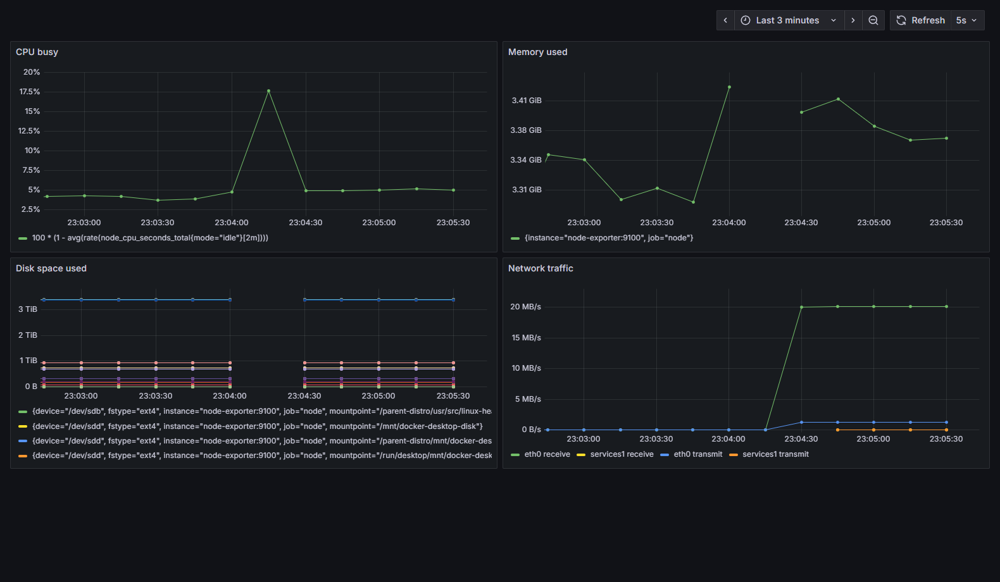
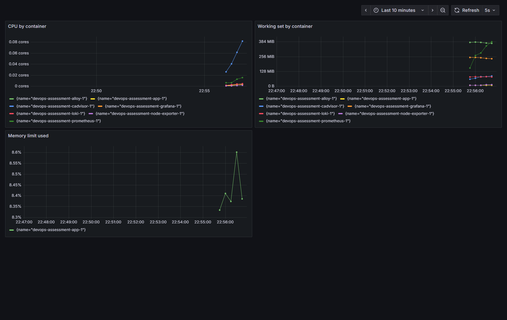

# DevOps assessment service

Run a three-endpoint Go service, observe its traffic in Grafana, and deploy two versions to a local Kubernetes cluster. The cloud release targets one EC2 instance using ECR, GitHub OIDC and Systems Manager.

[Actual verification results](docs/verification.md) · [Outstanding human steps and AWS runbook](docs/HUMAN_HANDOFF.md)

## Run locally

Use Docker Engine with Linux containers and Compose v2. On Windows, start Docker Desktop with the WSL2 backend and allow project-directory mounts. Ports 8080 and 3000 must be available. The exporters need a Linux engine with host mounts. On Docker Desktop the host dashboard describes the Docker Linux VM. Alloy discovers **all** containers on this engine; use a dedicated engine for a review session with unrelated sensitive workloads.

1. On a fresh checkout copy `.env.example` to `.env` and supply a unique Grafana admin password. For the existing local review workspace, the generated login is in the ignored `.env` file. Grafana initializes its admin credential on first startup against its data volume.
2. From the project root run `docker compose up -d --build` and `docker compose ps`. Wait for app health and at least two 15-second scrapes. Open [the service](http://127.0.0.1:8080/) and [Grafana](http://127.0.0.1:3000/). Sign in, then open Dashboards → Assessment → Application, Host or Containers.
3. Generate requests with the Bash loop below. Rate panels need more than one scrape to show a trend. Use `docker compose down` to stop this project and keep its data volumes.

```bash
for n in $(seq 1 100); do
  curl -fsS http://localhost:8080/ >/dev/null
  if [ "$n" -gt 30 ] && [ "$n" -lt 70 ]; then curl -s -o /dev/null http://localhost:8080/missing; fi
  sleep 1
done
```

| Endpoint | Result |
|---|---|
| GET / | 200 JSON with message "Hello from DevOps Task!", status "running" and the compiled version |
| GET /health | 200 while serving; 503 during the two-second drain window |
| GET /metrics | Prometheus exposition with app_requests_total, app_errors_total and app_request_duration_seconds histogram |

PORT defaults to 8080, LOG_LEVEL to info, APP_ENV to local. Unsupported methods on these routes return 405 and Allow: GET. Unknown routes return 404. Request logs on stdout contain timestamp, severity, route, path without query string, status, method, duration, environment and version. Both requests and metrics collection are concurrent. Each instance owns its counters. There are no business entities, database migrations, application credentials or external dependencies for serving a request.

## Architecture and design decisions



Go's standard HTTP server and JSON logger handle the API. The Prometheus client owns exposition, histogram buckets and concurrent metric updates. The repository keeps transport, lifecycle, metrics and their endpoint tests in `cmd/service/`. A compiled health-probe subcommand allows the same distroless non-root image to run Docker health checks without adding a shell. Both base manifests are digest-pinned. Docker reported **5,081,380 bytes** for the local linux/amd64 image using `docker image inspect assessment-service:1.0.0 --format '{{.Size}}'`. Platform, export format and registry compression affect measurements.

EC2 is the assessed deployment target. A single host keeps infrastructure cost and the rollback procedure understandable. ECS would supply a managed service scheduler; EKS would add a managed control plane. Kubernetes is exercised independently on kind. The app owns no durable state; operational state lives in Prometheus/Loki/Grafana volumes, S3, CloudWatch and the release registry.

## Observability and incident walkthrough







The Application screenshot includes an intentional burst of requests to a missing route. Select the interval where the 4xx line rises. Open the adjacent logs panel in Explore and query `{service="app",level="WARN"} | json | status = 404 | path = "/missing"`. Check the matching path, status, version and request time. Compare the same interval on Host and Containers. In this demonstration the requests themselves explain the 404s. For a 5xx spike, inspect ERROR logs and release timing, then check CPU and memory pressure before deciding whether to restore a prior release.

Prometheus scrapes the service, Node Exporter and cAdvisor every 15 seconds. Prometheus and Loki retain seven days; Loki uses the TSDB schema and retention-enabled compactor. Grafana provisions both data sources and all three dashboard JSON files at startup. Node Exporter reads network counters from host PID 1 through procfs. The traffic panel filters virtual bridge and veth interfaces to avoid double counting. Host data covers the engine's CPU, memory, mounted filesystems and interfaces. The container panels select this Compose project; percentage-of-limit includes finite positive limits. Alloy keeps container/service identity and bounded app severity as labels. Request paths remain JSON fields searched at query time. This prevents each distinct URL from creating a log stream.

| Alert | Threshold and reason |
|---|---|
| AppDown | One minute of failed app scrapes tolerates a short missed collection and surfaces sustained unavailability. |
| HighServerErrors | 5xx share above 5% over five minutes, at least 20 requests, sustained two minutes. The volume floor reduces noise on an idle service. |
| HostDiskPressure | Above 80% used for ten minutes on writable, capacity-bearing filesystems. Leaves time to reclaim space and filters transient writes. |
| ContainerMemoryPressure | Working set above 90% of a finite limit for five minutes. Sustained growth close to a hard limit can precede an OOM kill. |

## Tests and Linux automation

With Go 1.26.5 run `go vet ./...`, `go test -race -coverprofile=coverage.out ./...`, and `go tool cover -func=coverage.out`. The race detector needs a C compiler on Linux. The PR workflow checks formatting, tests and coverage, Hadolint, ShellCheck, Prometheus rules, the health CLI and a Trivy CRITICAL gate. To run the alert fixtures against the running stack:

```bash
docker compose exec -w /etc/prometheus prometheus promtool test rules tests.yml
```

On Linux install Bash, GNU coreutils, procps, util-linux (flock) and jq. Run `bash system_health.sh --help`, `bash system_health.sh --json`, and `bash scripts/test-health.sh`. CPU is sampled over one second, memory uses MemAvailable, disk includes all filesystem entries reported by df, and top processes are ordered by resident memory. A null disk percentage indicates unavailable capacity. The JSON stdout stream stays parseable when warnings go to stderr. The log always contains timestamped JSON lines.

Defaults are CPU 90%, memory 85%, disk 80% and critical 95%. Strictly exceeding a warning threshold yields exit 1; exceeding the common critical threshold yields 2. Healthy yields 0. Invalid inputs or collection errors yield 2. Example: `bash system_health.sh --cpu 80 --mem 85 --disk 75 --critical 95 --json`. HEALTH_LOG defaults to health_log.txt; HEALTH_LOG_MAX_BYTES defaults to 1048576. Writes and rotation use a lock and retain one backup. To install the five-minute job on a chosen host:

```bash
sudo install -d -m 0750 /var/log/assessment
sudo install -m 0755 system_health.sh /usr/local/sbin/system_health.sh
sudo install -m 0644 scripts/assessment-health.cron /etc/cron.d/assessment-health
```

## Kubernetes

Prerequisites: kind v0.30.0, kubectl, Docker, two local images, and Metrics Server v0.8.0. Run these Bash commands from the root on a fresh local setup. The empty local registry config is for preloaded images; for private ECR use a short-lived registry credential in this ignored file and refresh it when needed.

```bash
kind create cluster --name assessment-local --image kindest/node:v1.34.0
docker build -t assessment-service:1.0.0 .
docker build --build-arg VERSION=1.0.1 -t assessment-service:1.0.1 .
kind load docker-image assessment-service:1.0.0 assessment-service:1.0.1 --name assessment-local
# For preloaded images only; preserve any existing private registry config.
test -f k8s/registry.json || printf '{"auths":{}}\n' > k8s/registry.json
kubectl --context kind-assessment-local apply -k k8s/
kubectl --context kind-assessment-local apply -f https://github.com/kubernetes-sigs/metrics-server/releases/download/v0.8.0/components.yaml
kubectl --context kind-assessment-local -n kube-system patch deployment metrics-server --type=json \
  -p '[{"op":"add","path":"/spec/template/spec/containers/0/args/-","value":"--kubelet-insecure-tls"}]'
kubectl --context kind-assessment-local rollout status deployment/app
kubectl --context kind-assessment-local get hpa
kubectl --context kind-assessment-local port-forward service/app 18080:8080
```

The kubelet TLS exception addresses kind's development certificates. Access the app at http://127.0.0.1:18080. For an update test start an in-cluster observer in a second terminal. Use the same explicit context or an isolated KUBECONFIG. Run the update once the observer is Ready, then undo it and inspect the samples:

```bash
kubectl run observer --image=busybox:1.37.0 --restart=Never --command -- sh -c \
 'while true; do wget -q -T 2 -O - http://app:8080/ || echo FAILED; sleep 0.2; done'
kubectl wait --for=condition=Ready pod/observer
kubectl set image deployment/app app=assessment-service:1.0.1
kubectl rollout status deployment/app
kubectl rollout undo deployment/app
kubectl rollout status deployment/app
kubectl logs observer
kubectl delete pod observer
```

Observed output included `deployment "app" successfully rolled out`, `deployment.apps/app rolled back`, and a second successful rollout. The client received 54 successful responses across both versions. [Full recorded rollout results](docs/evidence/kubernetes.md).

For production EKS, use an ingress controller with TLS and a managed load balancer, signed kubelet certificates, external secret delivery, EKS Pod Identity or IAM roles for service accounts, and node autoscaling with capacity for surge replicas. Spread replicas across failure domains. Use managed worker image-pull identity for ECR. The development HPA uses CPU requests as its utilization baseline.

## Deployment and rollback strategy

See the [AWS bootstrap, variables, deployment and cleanup runbook](docs/HUMAN_HANDOFF.md). The PR workflow has read-only repository access. On main, quality checks run before Buildx publishes an amd64/arm64 image with layer caching. An immutable SHA and a semantic prerelease such as 1.0.0-build.42 identify one release. Re-running the same completed publish checks the immutable tags before deployment.

The release role assumes short-lived credentials through GitHub OIDC. It sends a custom SSM document to a specific instance. Bootstrap and deployment share one host script. The script locks releases, pulls the candidate before stopping the incumbent, checks /health and release identity, and restores the previous immutable reference on failure. Recovery still returns a failed release status. Single-host replacement can briefly interrupt requests. Kubernetes uses a surge replica and zero unavailable replicas during normal rollout.

## Security considerations

The app runs as UID/GID 65532, with a read-only root and dropped capabilities locally and on Kubernetes. Its runtime needs no inbound administrative port. The EC2 security group permits only the app port from a restricted CIDR, uses IMDSv2, and leaves port 22 closed. The instance has the SSM managed core policy, repository-scoped pull access and log writes scoped to its log group. Registry authentication requires the AWS wildcard-resource token action. S3 state uses locking and encryption. AWS account credentials, Terraform state, registry JSON and local environment files belong outside published files.

Only app 8080 and Grafana 3000 bind host loopback. The collectors share an internal Docker network. Node Exporter receives read-only host root/proc/sys views and the host PID namespace for host measurements. cAdvisor uses privileged runtime access and read-only rootfs, /sys, /var/run, Docker storage and /dev/disk for cgroups, runtime discovery and disk metadata. Alloy reads the Docker socket for discovery and log access. A read-only bind mount of a socket still permits powerful API calls. Run the stack on a trusted assessment engine. The host-root bind is static, so restart the exporter to include newly mounted filesystems where mount propagation is unavailable.

## Estimated monthly AWS cost

Illustrative budget for us-east-1, 730 hours, one on-demand Linux t3.micro, 8 GiB gp3, one public IPv4, 1 GB of CloudWatch log ingestion, minimal ECR/state storage and light traffic: **about USD 12–14/month** before tax, credits or free-tier discounts. Assumed rates give EC2 about $7.59, IPv4 $3.65, gp3 $0.64, log ingestion about $0.50 and small additional storage/request charges. Estimate prepared 19 November 2026. Traffic, CPU credit usage, retention and region affect the bill. The local monitoring stack and kind cluster use the reviewer's machine. [EC2 pricing](https://aws.amazon.com/ec2/pricing/on-demand/) · [VPC pricing](https://aws.amazon.com/vpc/pricing/) · [EBS pricing](https://aws.amazon.com/ebs/pricing/) · [CloudWatch pricing](https://aws.amazon.com/cloudwatch/pricing/).

## What I would improve with more time

A second EC2 deployment target behind a load balancer would reduce replacement downtime. A private, TLS-terminated service endpoint would improve the exposure model. Image signing and a verified SBOM would tie published artifacts to a trusted build. Operational alert routing would turn the existing alert rules into on-call notifications.

## AI assistance

OpenAI Codex assisted with assessment analysis, service and infrastructure implementation, documentation, and local test execution. The verification report distinguishes observed results from outstanding live-account evidence. Git history and public submission belong to the candidate.
